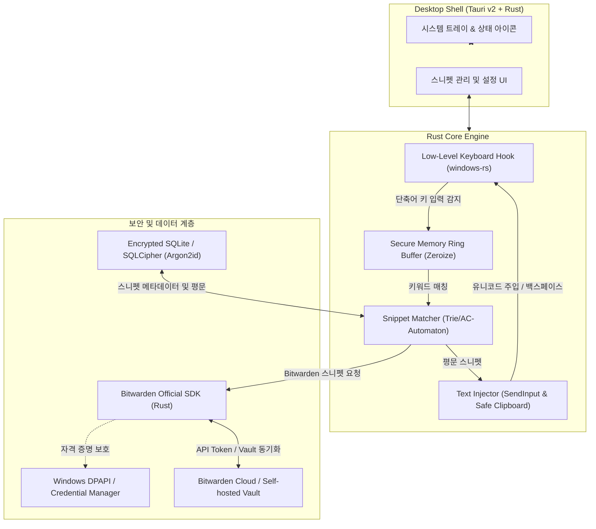
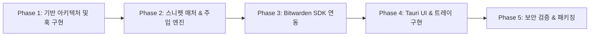

# Rust 기반 보안 텍스트 익스팬더 (Beeftext + Bitwarden) 개발 계획서

## 1. 개요 및 목표

본 프로젝트는 Windows 환경에서 경량으로 동작하는 오픈소스 텍스트 익스팬더인 **Beeftext**의 핵심 경험을 계승하면서, 스니펫 값으로 **일반 평문**뿐만 아니라 **Bitwarden 보관함(Vault)의 비밀번호, TOTP, 보안 메모, 계정 필드**를 즉각 치환 주입할 수 있는 Rust 기반 고보안 데스크톱 애플리케이션 구축을 목표로 합니다.

키보드 입력을 상시 감시하는 텍스트 익스팬더의 특성상 악의적인 키로거 오인 방지, 메모리 내 민감 정보 보호, 클립보드 기록 유출 방지 등 엄격한 보안 설계를 최우선으로 적용합니다.

---

## 2. 아키텍처 다이어그램

---

## 3. 권장 기술 스택

| 영역 | 선정 기술 | 선정 이유 |
| :--- | :--- | :--- |
| **코어 언어** | **Rust (Edition 2021)** | 무결성 보장, 무비용 추상화, 세밀한 메모리 제어(`Zeroize`, 포인터 보호), 고성능 |
| **GUI 프레임워크** | **Tauri v2 (Rust + 경량 웹 프론트엔드)** | - C++ 기반 Beeftext 대비 매우 가벼운 리소스 사용 - 시스템 트레이, 전역 단축키, 백그라운드 런타임 네이티브 지원 - 엄격한 IPC 격리(Capabilities & Permissions)로 프론트엔드 탈취 방지 |
| **Windows API 바인딩** | **windows-rs** | Microsoft 공식 최신 Windows API 바인딩 (`SetWindowsHookExW`, `SendInput`, `UI Automation`) |
| **Bitwarden 연동** | **bitwarden-sdk (Rust)** 또는 **REST API** | Bitwarden 공식 오픈소스 Rust SDK를 직접 바인딩하여 CLI 의존성 없이 인메모리 복호화 처리 |
| **로컬 스토리지** | **rusqlite + SQLCipher** 또는 **ChaCha20-Poly1305 단일 암호화 파일** | 일반 평문 스니펫 및 환경 설정을 로컬에 안전하게 저장 |
| **메모리 보안** | **zeroize + secrecy** | 민감한 키 입력 버퍼, 복호화된 Bitwarden 비밀번호의 메모리 잔존 방지 및 덤프 방어 |

---

## 4. 핵심 모듈별 상세 설계

### 4.1. 보안 키보드 리스너 및 링 버퍼 (`Secure Key Listener`)
- **윈도우 훅 연동**: `SetWindowsHookExW(WH_KEYBOARD_LL)`를 전용 백그라운드 스레드에서 구동합니다.
- **메모리 격리 버퍼**:
  - 고정 길이(예: 32자)의 안전한 순환 버퍼(`SecureRingBuffer`)를 운용합니다.
  - 버퍼에 담긴 키는 `zeroize::Zeroize` 트레이트를 구현하여, 키워드 매칭 완료 또는 타임아웃(예: 5초간 키 입력 부재) 시 즉시 메모리에서 영(0)으로 덮어씁니다.
  - `VirtualLock` API를 호출하여 해당 메모리 페이지가 스왑 파일(pagefile.sys)로 디스크에 유출되지 않도록 고정합니다.
- **비밀번호 필드 자동 감지 (Privacy Guard)**:
  - Windows UI Automation을 통해 현재 포커스된 컨트롤이 `IsPassword == true` 속성을 가지는지 확인합니다.
  - 비밀번호 입력창으로 확인되면 훅은 키 입력을 버퍼에 누적하지 않고 즉시 통과시킵니다.

### 4.2. 스니펫 매처 및 텍스트 인젝터 (`Snippet Matcher & Injector`)
- **스니펫 구조 정의**:
  - `PlainText`: 일반 치환 문구 (날짜 매크로, 커서 위치 지정 등 지원)
  - `BitwardenRef`: `{ item_id: "...", field: Password | Username | TOTP | Custom("apiKey") }`
- **치환 실행 방식**:
  1. 키워드 매칭 확인 시 키보드 훅 일시 차단 (재귀 호출 방지).
  2. 키워드 길이만큼 `VK_BACK` (백스페이스) `SendInput` 전송.
  3. 스니펫 값 주입:
     - **단문(1줄 이내)**: `KEYEVENTF_UNICODE`를 사용한 `SendInput`으로 직접 타이핑 (클립보드를 일절 거치지 않아 완벽한 보안 제공).
     - **장문(멀티라인)**: 속도를 위해 클립보드를 사용할 경우, Windows 전용 클립보드 포맷 플래그인 `CanIncludeInClipboardHistory = 0` 및 `ExcludeClipboardContentFromMonitorProcessing`을 활성화하여 Windows 클립보드 기록에 남지 않도록 주입 후 이전 클립보드 데이터를 즉시 복원합니다.

### 4.3. Bitwarden 보관함 연동 및 자격 증명 관리 (`Bitwarden Connector`)
- **인증 방식**:
  - Bitwarden API Key (Client ID, Client Secret) 및 마스터 패스워드 해시.
  - 자격 증명은 디스크에 평문 저장하지 않고 **Windows Credential Manager (DPAPI)**에 안전하게 위임합니다.
- **세션 수명 주기 (Vault Session Lifecycle)**:
  - 앱 시작 시 마스터 비밀번호 또는 Windows Hello(생체 인증/PIN) 인증을 요구합니다.
  - 복호화된 대칭키(Symmetric Key)는 메모리에만 존재하며, 설정된 유휴 시간(예: 15분) 경과 시 메모리를 소거하고 잠금 상태로 전환됩니다.
- **TOTP 실시간 생성**:
  - 스니펫 필드가 TOTP인 경우, 보관함의 TOTP 시크릿을 기반으로 주입 시점의 6자리 일회용 코드를 동적으로 계산하여 주입합니다.

### 4.4. 로컬 스니펫 스토리지 및 설정 (`Encrypted Storage`)
- Beeftext의 콤보(Combo) 및 그룹(Group) 데이터 구조를 수용합니다.
- SQLite 기반에 AES-256-GCM 또는 SQLCipher를 적용하여 로컬 DB 파일 자체를 암호화합니다.
- 암호화 키는 시스템 고유 엔트로피 + DPAPI를 결합하여 보호합니다.

---

## 5. 보안 위협 모델 및 대응 전략

| 위협 시나리오 | 위험도 | 완화 방안 |
| :--- | :---: | :--- |
| **메모리 덤프 공격** (프로세스 메모리 분석으로 키 입력이나 패스워드 탈취) | 높음 | - `zeroize`로 사용 직후 메모리 파기 - `VirtualLock`으로 스왑 파일 기록 차단 - 마스터 비밀번호 등은 복호화 직후 즉각 파기 |
| **클립보드 스누핑** (클립보드 매니저 앱이나 윈도우 기록에 비밀번호 잔존) | 높음 | - 소량 텍스트는 `SendInput(UNICODE)` 직접 타이핑 - 클립보드 사용 시 `ExcludeClipboardContentFromMonitorProcessing` 플래그 적용 후 즉시 원복 |
| **키로거 오인 및 안티바이러스 탐지** (전역 키보드 훅 동작으로 인한 오탐) | 중간 | - 키 이벤트 처리 속도를 마이크로초 단위로 최적화 - 실행 파일에 대해 디지털 서명(코드 사이닝) 또는 투명한 오픈소스 빌드 제공 - 비밀번호 입력창에서는 버퍼 적재 자체를 생략 |
| **Bitwarden 토큰 탈취** | 높음 | - 토큰 및 비밀값은 Windows DPAPI로 OS 레벨 암호화 보관 - 앱 유휴 시 자동 세션 잠금(Auto-lock) 기능 기본 활성화 |

---

## 6. 개발 로드맵 및 단계별 계획

### Phase 1: 기반 아키텍처 및 코어 훅 구현 (1~2주)
- Rust 워크스페이스 세팅 (`core-engine`, `bitwarden-client`, `desktop-app`)
- `windows-rs` 기반 Low-level Keyboard Hook 스레드 작성
- `Zeroize` 기반 보안 링 버퍼 구현 및 메모리 덤프 방어 테스트
- UI Automation 기반 비밀번호 필드 감지 로직 검증

### Phase 2: 스니펫 매칭 및 텍스트 주입 엔진 (1~2주)
- Trie 자료구조 기반 고속 키워드 매칭 엔진
- Backspace 연타 및 `SendInput` 유니코드 직접 주입 로직
- 안전한 클립보드 주입 및 복원 Fallback 구현
- Beeftext 스타일의 치환 트리거(스페이스바, 엔터, 즉시 치환 등) 지원

### Phase 3: Bitwarden 보관함 연동 모듈 (2주)
- Bitwarden 공식 SDK 또는 REST API 클라이언트 구현
- Windows Credential Manager 연동 자격 증명 보관
- 인메모리 보관함 복호화, 동기화, 캐싱 구조 수립
- 필드별 동적 주입 (Password, Username, TOTP, Custom Notes)

### Phase 4: Tauri v2 데스크톱 UI 및 시스템 트레이 (2주)
- 시스템 트레이 메뉴 (잠금/잠금 해제, 동기화, 일시 정지, 종료)
- 스니펫 관리 화면 (그룹 관리, 키워드 설정, 평문/Bitwarden 항목 연결 모달)
- 마스터 패스워드 입력창 및 Windows Hello 연동 다이얼로그
- 암호화된 로컬 SQLite 스토리지 구축

### Phase 5: 보안 감사 및 패키징 (1주)
- 프로세스 메모리 스캔 툴을 통한 메모리 잔존값 전수 검사
- 클립보드 관리 프로그램과의 간섭 및 잔존 여부 테스트
- Windows 경량 인스톨러(MSI / NSIS) 및 휴대용(Portable) 포맷 빌드
